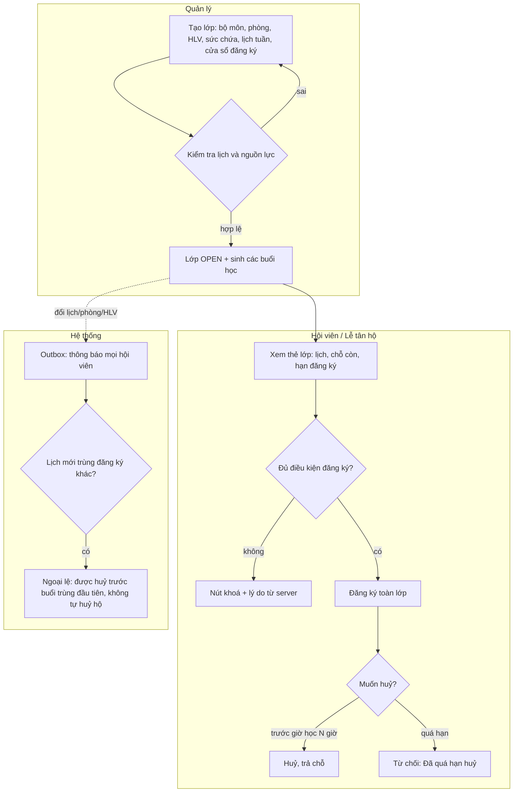

# 08 · Xếp lớp và đăng ký lớp (Flow 2)

Tài liệu giải thích **vì sao hệ thống cho hoặc không cho** xếp lớp / đăng ký lớp, đối chiếu từng business rule
(BR-2.x trong `07_Business_Rules.docx`) với code và test. Dùng để demo và trả lời câu hỏi "quy tắc này nằm ở đâu".

## 1. Hai việc khác nhau, hai người làm khác nhau

| Việc | Ai làm | Bản chất |
| --- | --- | --- |
| **Xếp lớp** (tạo / sửa / huỷ lớp, gán phòng + HLV + lịch) | Quản lý (`class.create/update/delete`) | Giữ cho **phòng và HLV không bị trùng giờ**, sức chứa hợp lệ |
| **Đăng ký lớp** (giữ chỗ toàn lớp, huỷ) | Hội viên tự làm, hoặc lễ tân làm hộ (`class.enroll_for_member`) | Giữ cho **hội viên không trùng giờ**, không vượt sức chứa, còn gói tập |

Đăng ký là **toàn lớp** (một bản ghi `ClassEnrollment` cho cả khoá), không đăng ký từng buổi.

## 2. Điều kiện đăng ký lớp (theo đúng thứ tự hệ thống kiểm tra)

Server tính, FE chỉ hiển thị (`enrollReason`); lễ tân đăng ký hộ dùng **cùng** quy tắc. Điều kiện đầu tiên không đạt sẽ là lý do hiển thị.

| # | Điều kiện | Lý do hiển thị khi không đạt | HTTP | BR |
| --- | --- | --- | --- | --- |
| 1 | Hội viên chưa đăng ký lớp này | Bạn đã đăng ký lớp này | 409 | - |
| 2 | Tài khoản hội viên đang hoạt động | Tài khoản hội viên đã bị khoá | 422 | BR-1.9 |
| 3 | Có membership còn hiệu lực (`start ≤ hiện tại < end`) | Cần membership còn hiệu lực | 422 | BR-2.1 |
| 4 | Lớp đang `OPEN` và trong cửa sổ đăng ký (`mở ≤ hiện tại < đóng`) | Lớp ngoài thời gian mở đăng ký | 422 | BR-2.6 |
| 5 | Lớp còn ít nhất một buổi chưa diễn ra | Lớp không còn buổi chưa diễn ra | 422 | BR-2.6 |
| 6 | Còn chỗ (`đã đăng ký < sức chứa`) | Lớp đã đủ chỗ | 422 | BR-2.2 |
| 7 | Không có buổi nào chồng giờ với lớp khác đã đăng ký | Trùng lịch với lớp đã đăng ký | 422 | BR-2.3, 2.8 |

Ghi chú quan trọng:
- **Trùng giờ** tính theo từng buổi cụ thể: `A.bắt đầu < B.kết thúc` **và** `B.bắt đầu < A.kết thúc`. Hai buổi liền nhau (19:00 kết thúc, 19:00 bắt đầu) **không** trùng; chồng 1 phút thì trùng.
- Mọi phép ghi lịch/đăng ký chạy tuần tự qua một khoá chung (`ScheduleLock`), nên hai người tranh chỗ cuối hoặc một người đăng ký hai lớp trùng giờ cùng lúc chỉ thành công một.
- Gói tập chỉ được kiểm tra **tại lúc đăng ký**. Gói hết hạn giữa kỳ thì các lớp đã đăng ký vẫn giữ nguyên (BR-1.12), chỉ chặn đăng ký mới.
- Đăng ký lại sau khi đã huỷ **dùng lại** bản ghi cũ (không tạo bản ghi mới).

## 3. Điều kiện huỷ đăng ký

`được huỷ = (hiện tại ≤ giờ bắt đầu buổi gần nhất chưa diễn ra − N giờ) HOẶC (đang trong ngoại lệ đổi lịch)`

- N lấy từ `system_settings` (`CLASS_CANCEL_MIN_HOURS_BEFORE`, mặc định 12) và đổi được trên giao diện, không cần sửa code.
- Đúng mốc N giờ vẫn được huỷ; trễ 1 mili-giây thì bị từ chối (BR-2.14). Lý do: Đã quá hạn huỷ.
- **Ngoại lệ đổi lịch (BR-2.15):** nếu quản lý đổi lịch làm lớp trùng với lớp khác của hội viên, hội viên được huỷ trước buổi trùng đầu tiên. Hệ thống chỉ thông báo, **không tự huỷ hộ**.

## 4. Điều kiện khi quản lý tạo / sửa lớp

Thứ tự kiểm tra: dữ liệu đầu vào (400) → lịch (422) → nguồn lực (422/409).

| Kiểm tra | Kết quả | BR |
| --- | --- | --- |
| Ngày kết thúc ≥ ngày bắt đầu; giờ kết thúc > giờ bắt đầu; ít nhất 1 buổi/tuần; đóng đăng ký sau lúc mở | 400 | BR-2.11 |
| Có ít nhất một buổi chưa diễn ra; các buổi không chồng nhau; đăng ký đóng trước buổi cuối | 422 | BR-2.11 |
| Bộ môn, phòng đang hoạt động; HLV đang hoạt động **và** có quyền dạy | 422 | BR-2.13 |
| Sức chứa lớp ≤ sức chứa phòng | 422 | BR-2.10 |
| Phòng hoặc HLV không trùng giờ với lớp khác chưa huỷ | 409 | BR-2.4 |
| Khi sửa: sức chứa mới ≥ số đã đăng ký | 422 | BR-2.9 |
| Khi sửa lịch: không đổi nếu lớp đang có buổi diễn ra | 422 | - |

Tác động phụ: đổi lịch/phòng/HLV hoặc huỷ lớp luôn gửi thông báo cho mọi hội viên đang đăng ký (BR-2.7) qua outbox bền vững; gửi lỗi thì thử lại, không gửi trùng. Ngừng phòng/bộ môn còn lớp đang dùng, hoặc khoá HLV đang dạy, đều bị chặn (BR-2.12, 2.13).

## 5. Ma trận BR → code → test

| BR | Code | Test |
| --- | --- | --- |
| 2.1 | `class-booking-policy.service.js` (`enrollmentReason`) | TC-F2-B02, B07, K09, e2e V03 |
| 2.2 | `class-booking-policy.service.js`; khoá `ScheduleLock` | TC-F2-B01, K06 |
| 2.3 | `class-booking-policy.service.js` (`getClassActions`) | TC-F2-B04, K05, K08 |
| 2.4 | `class-schedule.service.js` (`validateResources`) | TC-F2-C02 |
| 2.5 / 2.14 | `class-booking-policy.service.js` (`cancellationPolicy`) | TC-F2-P01..P03, B06, N01 |
| 2.6 | `class-booking-policy.service.js` (`isRegistrationOpen`) | TC-F2-B03, K07 |
| 2.7 | `class-event.service.js` (outbox) | TC-F2-C04, C06, R04 |
| 2.8 | `class-schedule.service.js` (`overlaps`) | TC-F2-C02, K05 |
| 2.9 | `class.service.js` (`update`) | TC-F2-K01 |
| 2.10 | `class-schedule.service.js`; `catalog.service.js` (sức chứa phòng) | TC-F2-K02, R06 |
| 2.11 | `class.validation.js`; `buildSessions` | TC-F2-K03 |
| 2.12 | `catalog.service.js` | TC-F2-C03 |
| 2.13 | `validateResources`; `coach-availability.service.js` | TC-F2-C03, K04 |
| 2.15 | `class-exception.service.js` | TC-F2-B09, P02 |

## 6. Kịch bản demo (desktop)

Chuẩn bị: `npm run dev`, đã `npm run db:seed`. Cần một hội viên có gói còn hạn (lễ tân tạo hoá đơn quầy và thu tiền mặt, xem mục thanh toán). Tài khoản mẫu: quản lý, lễ tân `letan@scms.local`, HLV, hội viên (mật khẩu mẫu trong `.env`).

| Bước | Vai trò | Thao tác | Kết quả cần thấy |
| --- | --- | --- | --- |
| 1 | Quản lý | Tab **Quản lý lớp** → Tạo lớp (phòng, HLV, lịch 2 buổi/tuần) | Thẻ lớp hiện lịch "Thứ …, Thứ … · giờ", khoảng ngày; **không** có nút đăng ký |
| 2 | Quản lý | Tạo lớp thứ hai cùng phòng, giờ chồng | Báo 409 "Phòng hoặc HLV bị trùng lịch" |
| 3 | Hội viên | **Lớp đang mở** → Đăng ký lớp | "Đã đăng ký lớp", chỗ còn giảm 1, hiện "Hạn huỷ lớp" |
| 4 | Hội viên | Xem lớp khác chồng giờ (khác phòng/HLV) | Nút khoá, lý do "Trùng lịch với lớp đã đăng ký" |
| 5 | Lễ tân | **Đăng ký / huỷ hộ** → tìm email hội viên → chọn → Đăng ký hộ | Đăng ký được; nhật ký ghi người thực hiện là lễ tân |
| 6 | Hội viên | Lớp đầy chỗ | Nút khoá, lý do "Lớp đã đủ chỗ" |
| 7 | Quản lý | Sửa lịch lớp đã có người đăng ký | Hội viên nhận thông báo; nếu trùng lớp khác thì được huỷ trước buổi trùng |
| 8 | Hội viên | Huỷ khi còn xa buổi học / sát buổi học | Huỷ được / "Đã quá hạn huỷ" |
| 9 | HLV | **Lịch dạy**, **Danh sách học viên** | Chỉ thấy lớp mình phụ trách |

Ảnh nghiệm thu bước 1, 3, 4, 5: `outputs/xep-lop-nghiem-thu/` (kịch bản `tests/e2e/class-booking-flow.spec.mjs`).

## 7. Quyết định thiết kế và giới hạn đã biết

- Trạng thái lớp `CLOSED` do quản lý đặt tay; hệ thống không tự đóng khi đầy chỗ hay hết hạn đăng ký (đã có điều kiện 4 và 6 chặn đăng ký).
- Lịch lưu theo giờ Việt Nam (+07:00) cố định, không phụ thuộc múi giờ máy chạy.
- Buổi đã diễn ra và snapshot phòng/HLV cũ được giữ nguyên khi đổi lịch, để lịch sử không bị viết lại.
- Chưa có điểm danh từng buổi (thuộc Sprint sau); đăng ký hiện là toàn lớp.
