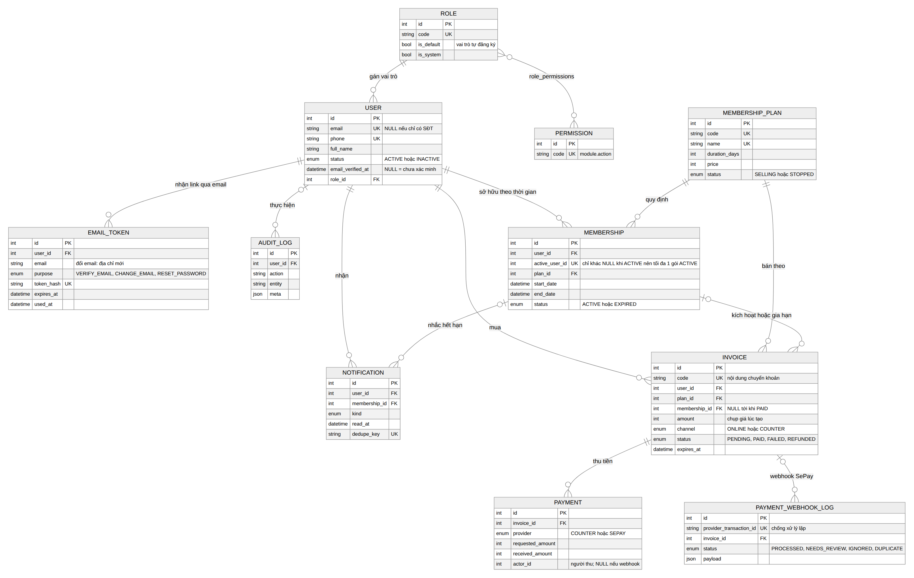
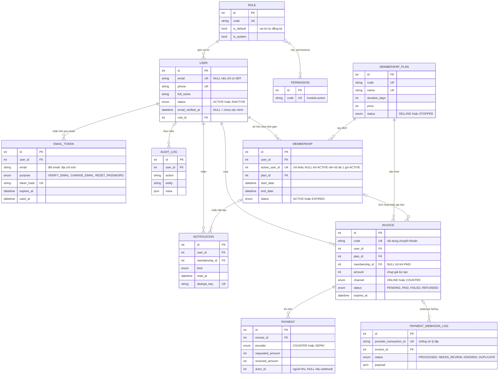
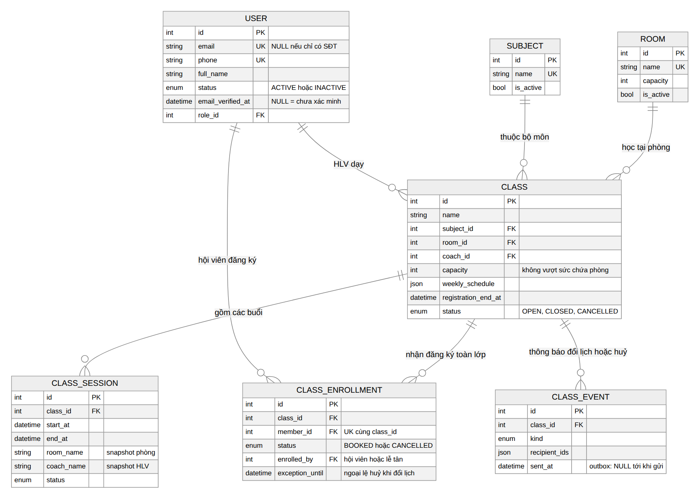

# 09 · ERD (bản cập nhật) và kịch bản demo

ERD cũ (`outputs/ERD-Conceptal.png`) vẽ trước khi làm Sprint 1 và 2. Bản này khớp với **schema đang chạy**
(`core/be/prisma/schema.prisma`). Mã nguồn sơ đồ là Mermaid (GitHub hiển thị trực tiếp); ảnh PNG nằm ở `docs/assets/`.

## 1. Khác gì so với ERD cũ

| Mục | ERD cũ | Thực tế đang chạy | Vì sao |
| --- | --- | --- | --- |
| `MEMBERSHIP` – `INVOICE` | 1 – 1 ("kích hoạt") | **1 – N**: nhiều hoá đơn cùng trỏ vào một membership | Gia hạn khi còn hạn **cộng dồn vào đúng dòng membership đang có** (BR-1.3), nên mỗi lần gia hạn thêm một hoá đơn nhưng không thêm membership |
| `USER` – `MEMBERSHIP` | 1 – N, không nói gì thêm | 1 – N theo thời gian nhưng **tối đa 1 dòng `ACTIVE`** | `active_user_id` là khoá duy nhất, chỉ khác `NULL` khi `ACTIVE` (BR-1.2); gói hết hạn chuyển `EXPIRED` và giữ làm lịch sử |
| `INVOICE` | không có kênh | có `channel` (`ONLINE` / `COUNTER`), `expires_at`, giá chụp lúc tạo | Phân biệt thu tại quầy và chuyển khoản; không đổi hoá đơn cũ khi đổi giá gói |
| `PAYMENT` | 1 bảng | thêm `provider` (`COUNTER` / `SEPAY`), số tiền yêu cầu và thực nhận, người thu | Webhook không có người thu (`actor_id` rỗng) |
| webhook | chưa có | **`PAYMENT_WEBHOOK_LOG`** | Chống xử lý lặp theo mã giao dịch SePay; ca không tự khớp được ghi `NEEDS_REVIEW` |
| token email | chưa có | **`EMAIL_TOKEN`** (3 mục đích: xác minh, đổi email, đặt lại mật khẩu) | Một bảng, phân biệt bằng `purpose`; chỉ lưu hash |
| lớp học | `CLASS`, `CLASS_SESSION`, `ENROLLMENT` | thêm `SUBJECT`, `ROOM`, `CLASS_EVENT`; đăng ký là **toàn lớp** (`CLASS_ENROLLMENT`) | Lịch sử đăng ký giữ nguyên khi đổi lịch; `CLASS_EVENT` là outbox thông báo bền vững |
| `SESSION_ATTENDANCE`, `TRAINING_*`, `AI_*` | có | **chưa vào schema/chưa dùng** | Thuộc sprint sau (xem mục 5) |

## 2. Sơ đồ: tài khoản, gói tập, thanh toán





## 3. Sơ đồ: lớp học và đăng ký



```mermaid
erDiagram
  USER ||--o{ CLASS : "HLV dạy"
  USER ||--o{ CLASS_ENROLLMENT : "hội viên đăng ký"
  SUBJECT ||--o{ CLASS : "thuộc bộ môn"
  ROOM ||--o{ CLASS : "học tại phòng"
  CLASS ||--o{ CLASS_SESSION : "gồm các buổi"
  CLASS ||--o{ CLASS_ENROLLMENT : "nhận đăng ký toàn lớp"
  CLASS ||--o{ CLASS_EVENT : "thông báo đổi lịch hoặc huỷ"

  USER {
    int id PK
    string email UK "NULL nếu chỉ có SĐT"
    string phone UK
    string full_name
    enum status "ACTIVE hoặc INACTIVE"
    datetime email_verified_at "NULL = chưa xác minh"
    int role_id FK
  }
  SUBJECT {
    int id PK
    string name UK
    bool is_active
  }
  ROOM {
    int id PK
    string name UK
    int capacity
    bool is_active
  }
  CLASS {
    int id PK
    string name
    int subject_id FK
    int room_id FK
    int coach_id FK
    int capacity "không vượt sức chứa phòng"
    json weekly_schedule
    datetime registration_end_at
    enum status "OPEN, CLOSED, CANCELLED"
  }
  CLASS_SESSION {
    int id PK
    int class_id FK
    datetime start_at
    datetime end_at
    string room_name "snapshot phòng"
    string coach_name "snapshot HLV"
    enum status
  }
  CLASS_ENROLLMENT {
    int id PK
    int class_id FK
    int member_id FK "UK cùng class_id"
    enum status "BOOKED hoặc CANCELLED"
    int enrolled_by FK "hội viên hoặc lễ tân"
    datetime exception_until "ngoại lệ huỷ khi đổi lịch"
  }
  CLASS_EVENT {
    int id PK
    int class_id FK
    enum kind
    json recipient_ids
    datetime sent_at "outbox: NULL tới khi gửi"
  }
```

Bản đầy đủ một ảnh: `assets/erd-v2.png` (nguồn `assets/erd-v2.mmd`).

## 4. "Một user có nhiều membership?" – mô phỏng bằng dữ liệu thật

Trả lời ngắn: **có nhiều dòng theo thời gian, nhưng tại một thời điểm chỉ có tối đa một dòng `ACTIVE`.**
Dữ liệu dưới đây chụp từ hệ thống thật (gói "Khởi động 30 ngày", 360.000 ₫, 30 ngày; mua online qua webhook SePay).

**Kịch bản A – mua lần đầu** (chưa có gói): tạo 1 membership.

| membership | status | start | end | active_user_id |
| --- | --- | --- | --- | --- |
| 295 | ACTIVE | 13/10 | 12/11 | có giá trị |

| hoá đơn | kênh | trạng thái | trỏ tới membership |
| --- | --- | --- | --- |
| INV000251 | ONLINE | PAID | 295 |

**Kịch bản B – gia hạn khi còn hạn**: **không** tạo dòng mới; hạn cộng dồn 30 ngày vào dòng đang có (12/11 → 12/12), hội viên không mất ngày còn lại.

| membership | status | start | end | active_user_id |
| --- | --- | --- | --- | --- |
| 295 | ACTIVE | 13/10 | **12/12** | có giá trị |

| hoá đơn | kênh | trạng thái | trỏ tới membership |
| --- | --- | --- | --- |
| INV000251 | ONLINE | PAID | 295 |
| INV000252 | ONLINE | PAID | **295** (cùng membership: đây là lý do quan hệ là 1 – N) |

**Kịch bản C – hết hạn rồi mua lại**: dòng cũ chuyển `EXPIRED` và **giữ làm lịch sử**; tạo dòng mới bắt đầu từ ngày thanh toán (không nối tiếp từ ngày hết hạn cũ, BR-1.4).

| membership | status | start | end | active_user_id |
| --- | --- | --- | --- | --- |
| 295 | **EXPIRED** | 13/10 | 12/10 (giả lập hết hạn) | `NULL` |
| 296 | **ACTIVE** | 13/10 | 12/11 | có giá trị |

| hoá đơn | kênh | trạng thái | trỏ tới membership |
| --- | --- | --- | --- |
| INV000251, INV000252 | ONLINE | PAID | 295 |
| INV000253 | ONLINE | PAID | **296** |

Cách chứng minh khi demo: sau mỗi bước chạy truy vấn dưới (thay `<id>` bằng mã hội viên) hoặc xem trang Hồ sơ cá nhân của hội viên.

```sql
SELECT id, status, DATE(start_date) AS start_date, DATE(end_date) AS end_date, active_user_id
FROM memberships WHERE user_id = <id> ORDER BY id;
SELECT code, channel, status, membership_id FROM invoices WHERE user_id = <id> ORDER BY id;
```

Thu tiền mặt tại quầy dùng **cùng một hàm kích hoạt** (`activatePaidInvoice`) nên cho kết quả giống hệt; lễ tân còn thấy trước tác động
("gia hạn cộng dồn" hay "bắt đầu gói mới") ngay trong hộp thoại thu tiền.

## 5. Bảng có trong DB nhưng chưa dùng

Migration đầu (Flow 3 và 4) đã tạo sẵn một số bảng mà code chưa dùng, nên không vẽ vào ERD: `attendances`, `check_ins`,
`training_plans`, `training_exercises`, `exercise_completions`, `training_results`, `enrollments` (bản đăng ký theo buổi, đã thay bằng
`class_enrollments`) và `password_reset_tokens` (đã thay bằng `EMAIL_TOKEN` với `purpose = RESET_PASSWORD`). Khi làm Sprint 3 cần chốt
dùng hay bỏ từng bảng.

## 6. Kịch bản demo tổng cho giảng viên (khoảng 15 phút)

Chuẩn bị một lần: `npm run dev`; `npm run db:seed`; `core/be/.env` có `SEPAY_WEBHOOK_API_KEY` (trùng key khai báo trên SePay);
mở ngrok trỏ cổng 3000 và dán URL `.../api/v1/payments/sepay/webhook` vào SePay Test mode; trong Cài đặt → Thanh toán nhập
tài khoản nhận tiền; trong Cài đặt → Trung tâm nhập link Zalo/Facebook. Chỉ demo giao diện desktop.

| # | Phần | Thao tác | Kết quả cần thấy | Ảnh nghiệm thu |
| --- | --- | --- | --- | --- |
| 1 | Tài khoản | Đăng ký hội viên mới | Không vào hệ thống; màn "Hãy kiểm tra email" có Zalo/Facebook/điện thoại | `outputs/email-nghiem-thu/1`, `2` |
| 2 | Tài khoản | Thử đăng nhập khi chưa xác minh | Bị chặn kèm hướng dẫn | `outputs/email-nghiem-thu/2` |
| 3 | Tài khoản | Lễ tân → Hội viên → mở hồ sơ → Xác minh email | Hội viên thành "Đã xác minh"; có nhật ký | `outputs/email-nghiem-thu/3` đến `5` |
| 4 | Tài khoản | Quên mật khẩu → đặt lại | Link dùng một lần, phiên cũ bị đăng xuất | `outputs/email-nghiem-thu/6`, `7` |
| 5 | Thanh toán online | Hội viên chọn gói | Hoá đơn **ONLINE** có mã QR, đúng số tiền | `outputs/sepay-nghiem-thu/2` |
| 6 | Thanh toán online | Bắn webhook (SePay "Mô phỏng giao dịch" hoặc curl) | Trang tự chuyển "Đã thanh toán"; gói kích hoạt | `outputs/sepay-nghiem-thu/3` đến `5` |
| 7 | Thanh toán online | Bắn webhook sai số tiền | `NEEDS_REVIEW`, hoá đơn vẫn chờ | báo cáo SePay |
| 8 | ERD | Mua thêm gói khi còn hạn, rồi chạy SQL mục 4 | Hạn cộng dồn, cùng một membership, hai hoá đơn | mục 4 |
| 9 | Tại quầy | Lễ tân tạo hoá đơn quầy, thu tiền mặt | Thấy "Tác động lên gói tập"; biên lai kênh "Tiền mặt tại quầy" | `outputs/quay-nghiem-thu/` |
| 10 | Xếp lớp | Quản lý tạo lớp; hội viên đăng ký | Thẻ lớp có lịch học; chỗ giảm | `outputs/xep-lop-nghiem-thu/1` đến `3` |
| 11 | Xếp lớp | Đăng ký lớp chồng giờ | Nút khoá, lý do rõ | `outputs/xep-lop-nghiem-thu/4` |
| 12 | Xếp lớp | Lễ tân đăng ký hộ | Nhật ký ghi người thực hiện | `outputs/xep-lop-nghiem-thu/5`, `6` |

Lệnh bắn webhook thử (thay giá trị trong `< >`; `id` phải khác nhau mỗi lần):

```bash
curl -X POST https://<domain-ngrok>/api/v1/payments/sepay/webhook \
  -H "Authorization: Apikey <SEPAY_WEBHOOK_API_KEY>" -H "Content-Type: application/json" \
  -d '{"id":<số-mới>,"transferType":"in","transferAmount":<đúng-số-tiền>,"code":"<mã-hoá-đơn>","content":"<mã-hoá-đơn>"}'
```

Tài liệu liên quan: quy tắc xếp lớp `08-xep-lop-hoc.md`; báo cáo nghiệm thu từng mục nằm cạnh ảnh trong `outputs/*-nghiem-thu/`.
