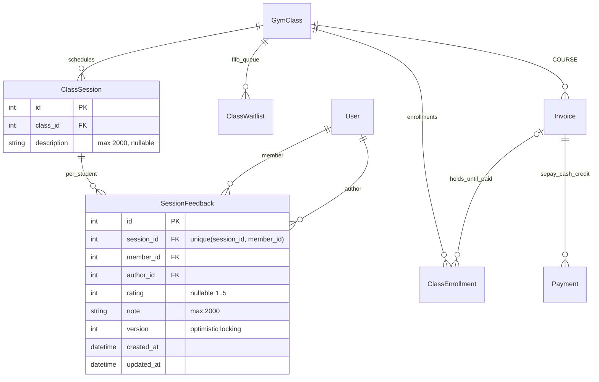

# Khóa học và nhận xét theo buổi – 03/11/2026

Bổ sung cho ERD Sprint 4. Các bảng gói tự tập vẫn tồn tại chỉ để bảo toàn FK/hóa đơn lịch sử;
API bán gói đã ngừng. Không chuyển hoặc sửa giá của invoice lịch sử khi cập nhật khóa học.

- `GymClass.description` mô tả khóa; `price` là giá trọn khóa. Invoice snapshot `sessionCount/totalSessions/amount` tính tại thời điểm giữ chỗ.
- Thanh toán đủ biến `PENDING_PAYMENT` thành `BOOKED` trong cùng transaction. Cả online/tại quầy dùng hạn giữ chỗ, không giữ vô hạn.
- Hết chỗ có thể vào `WAITING`, được mời thành `OFFERED`; chuyển từ offer sang giữ chỗ được tuần tự hoá với mọi phép ghi sức chứa.
- `SessionFeedback` không có quan hệ ghi đè attendance; lưu nhận xét không tạo trạng thái điểm danh. Ghi chú của người khác không được đưa vào DTO lớp public.
- Version + audit bảo vệ ghi đè đồng thời và truy vết người sửa. Ghi chú cá nhân được trả theo JWT, không theo memberId client gửi.
