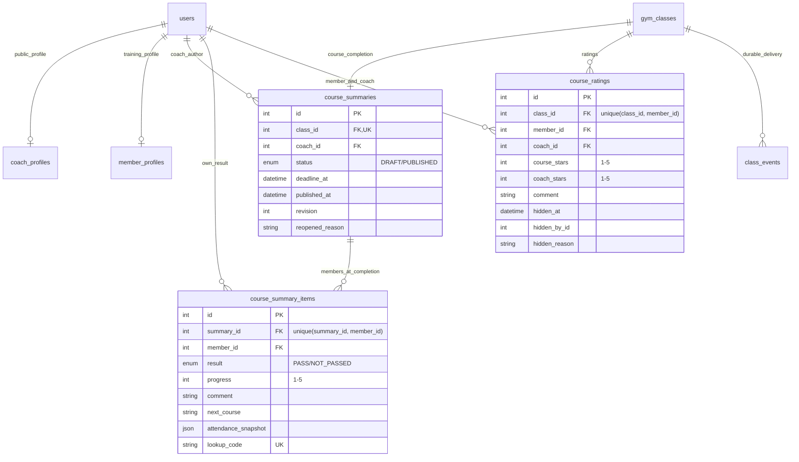

# ERD bổ sung Sprint 4

Phần bổ sung cho ERD hiện có, theo migration `20261029073309_sprint4_profiles_summaries_ratings`.
Các bảng legacy được giữ nguyên. Chi tiết tên cột, chỉ mục và FK nằm trong `core/be/prisma/schema.prisma`.

- `GymClass.status` thêm `COMPLETED`. Job không tổng kết lớp CANCELLED hoặc lớp chỉ có buổi đã huỷ.
- Các dòng `course_summary_items` là tập hội viên BOOKED lúc khoá kết thúc. Service xác thực người đánh giá có item ở lớp tương ứng; quan hệ này là ràng buộc nghiệp vụ, không phải FK trực tiếp.
- Chuyên cần lấy từ bảng `attendance` hiện hành (PRESENT/ABSENT/EXCUSED), không dùng `attendances` legacy. Snapshot được chốt lúc công bố.
- `CourseSummary.coachId` cố định HLV chịu trách nhiệm lúc kết thúc, độc lập snapshot HLV từng buổi.
- `class_events.changes` chứa `type=COURSE_SUMMARY_PUBLISHED`, `summaryId`, `revision`, `emailDeliveredTo` (ID, không chứa email/điểm). Dùng outbox hiện có để gửi in-app và retry email từng người, không cần thêm migration cho hàng đợi.
- Hồ sơ HLV lưu ảnh JPG/PNG trong `avatar_data`/`avatar_mime`; thông tin liên hệ công khai tách tài khoản đăng nhập. Hồ sơ hội viên có `share_with_coach` kiểm soát chia sẻ mục tiêu/sức khoẻ. API phần hồ sơ do Khôi phụ trách.
